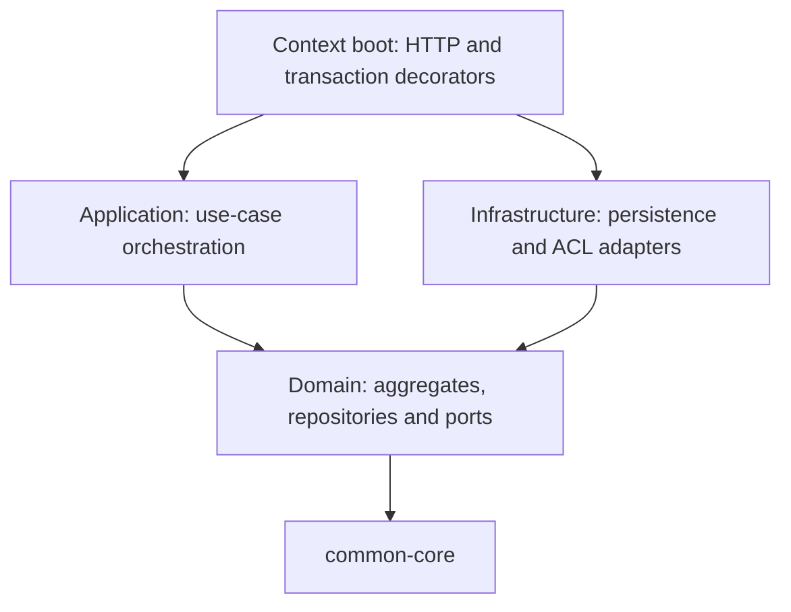

# Architecture & Design

## Runtime and Ownership

j-store is currently a modular monolith with an independent administration frontend. Each bounded context owns its business facts; other contexts consume scalar contracts, immutable snapshots or eventually consistent mirrors. Module boundaries do not imply independent deployment.

| Owner | Authoritative facts |
| --- | --- |
| Catalog | Published product content and stable SKU identities |
| Store / Offer | Sales eligibility, price and SaleAuthorization |
| WMS | Physical inventory and source version |
| Inventory / ATP | Available-to-promise and StockReservation |
| Cart | Mutable intent and content version; assessment is derived |
| Trade | Checkout idempotency, plans, commitments and settlement coordination |
| Order | Individual-order snapshots, lifecycle and after-sale capacity |
| Payment | Provider interaction and installment payment facts |
| User | Authentication-domain-local accounts and authentication facts |

**Sources** · [Ownership and contracts:15-62](file:///Users/101bjb0467/Sources/j-store/docs/domain-modeling.md#L15-L62)

## Layering

Business failures use `Result<T, BusinessError>`. Repository interfaces belong to domain; JPA entities and adapters belong to infrastructure. Cross-context queries use published `*-api` contracts and consumer-owned ACLs; cross-context writes use versioned integration messages. Application services do not embed framework-specific transaction management.

**Sources** · [Layering and conventions:134-159](file:///Users/101bjb0467/Sources/j-store/docs/project-overview.md#L134-L159)

## Transaction and Message Boundaries

A local use-case transaction saves aggregate state and Outbox publications together. Persistent resource commitments are SaleAuthorization and StockReservation, not JVM locks or a cross-context database transaction. Database locks use stable ordering for local races. Business versions, JPA concurrency versions and WMS source versions have different semantics.

Trade creates an independent `tradeId`, freezes direct-purchase or fresh Cart input, groups lines by merchant/fulfillment node, coordinates authorization and reservation, and then sends internal Order creation commands. Settlement preparation follows all Order results and an amount-conservation barrier. Payment provider calls sit between independent durable transactions.

**Sources** · [Transactions and messages:203-228](file:///Users/101bjb0467/Sources/j-store/docs/domain-modeling.md#L203-L228) · [Trade protocol:139-164](file:///Users/101bjb0467/Sources/j-store/docs/domain-modeling.md#L139-L164) · [Payment transaction phases:35-103](file:///Users/101bjb0467/Sources/j-store/backend/j-store-payment-boot/src/main/kotlin/com/jstore/payment/config/TransactionalTradePaymentPreparationUseCase.kt#L35-L103)

## Public Contract and Delivery Status

Checkout currently exposes creation and query, not a public cancellation operation. Order exposes query/list/cancel, not public creation. OIDC authentication uses RSA signing and persistent authorization/session checks. A minimal frontend, local provider adapters or simulated identity-provider tests do not demonstrate production delivery.

**Sources** · [Checkout controller:29-158](file:///Users/101bjb0467/Sources/j-store/backend/j-store-trade-boot/src/main/kotlin/com/jstore/trade/controller/CheckoutController.kt#L29-L158) · [OIDC signing and verifier:69-201](file:///Users/101bjb0467/Sources/j-store/backend/j-store-user-boot/src/main/kotlin/com/jstore/user/oidc/OidcConfiguration.kt#L69-L201) · [Delivery limits:126-129](file:///Users/101bjb0467/Sources/j-store/docs/project-overview.md#L126-L129)
