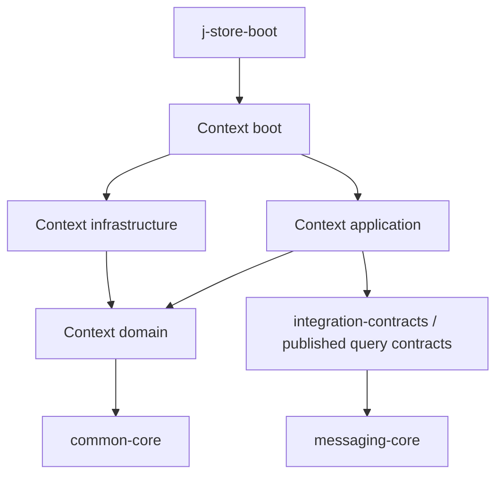

# Module Architecture & Dependencies

## Build Roots

`backend/settings.gradle.kts` registers 64 JVM modules. `frontend/` is an independent pnpm workspace and does not participate in Gradle. Shared documents, scripts, licenses and formatting resources remain at repository root.

**Sources** · [All registrations:5-133](file:///Users/101bjb0467/Sources/j-store/backend/settings.gradle.kts#L5-L133) · [Root layout:9-39](file:///Users/101bjb0467/Sources/j-store/docs/project-overview.md#L9-L39)

## Context Modules

Trade, Order, Catalog, User, Shop, Accounting, Payment, Fulfillment, Inventory, Cart and Warehouse have domain/application/infrastructure/boot layers. Published query/source contracts exist where needed: `goods-api`, `shop-api`, `inventory-api`, `cart-api`, `order-api`, `payment-api` and `user-api`. An `api` module is a cross-context contract, not an HTTP controller module.

`j-store-boot` composes runtime contexts and database migrations. `j-store-admin-boot` remains a JVM skeleton, not the frontend or a completed administration BFF. `user-client-spring` provides an optional remote profile-query adapter; `authentication-spring-sdk` provides MVC authentication integration without depending on User domain.

**Sources** · [Context module responsibilities:91-115](file:///Users/101bjb0467/Sources/j-store/docs/project-overview.md#L91-L115)

## Shared Capabilities

| Module | Responsibility |
| --- | --- |
| dependencies-platform | Central BOM imports and approved dependency constraints; no runtime code |
| common-core | Framework-independent identifiers, aggregates, errors, Result and shared primitives |
| common-spring | Shared geographic-address Spring adapter |
| observability-spring | Actuator, metrics, tracing and correlation |
| messaging-core | Framework-independent message contracts, buses and transport SPI |
| messaging-local-spring | In-process domain/integration message buses |
| outbox-core | Immutable publication, sequence allocation, routing and backend contracts |
| outbox-spring | Serialization, transactional publication and conditional polling persistence/relay |
| integration-contracts | Versioned scalar cross-context commands/events |

**Sources** · [Shared module responsibilities:82-90](file:///Users/101bjb0467/Sources/j-store/docs/project-overview.md#L82-L90)

## Dependency Direction



Queries use consumer ACLs over published contracts; writes use versioned messages. Accounting queries `order-api`, Trade queries `payment-api`, and consumer merchant authorization queries `shop-api`. Framework dependencies and JPA mappings stay outside domain. All JVM classpaths receive the central dependency Platform through common build configuration.

**Sources** · [Published query direction:62](file:///Users/101bjb0467/Sources/j-store/docs/domain-modeling.md#L62-L62) · [Platform injection:54-71](file:///Users/101bjb0467/Sources/j-store/backend/build.gradle.kts#L54-L71)

## Verification Entry Points

```bash
./scripts/backend-gradle.sh projects
./scripts/backend-gradle.sh :j-store-trade-domain:test :j-store-trade-application:test
./scripts/quality-gate.sh
pnpm --dir frontend check
```

Use current module build scripts and governance tests to verify actual dependency edges. This overview states architecture and observed registration, not a fresh dependency-resolution or test result.
