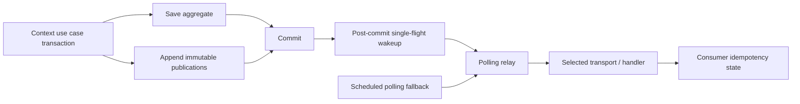

# Outbox Pattern Implementation

## Module Boundaries

Outbox no longer lives inside common-core/common-spring. `outbox-core` contains framework-independent immutable messages, append/backend contracts, sequence allocation and target routing. `outbox-spring` provides Jackson serialization, transactional publication and the conditional polling backend. Mutable polling entry/status/repository types belong to `com.jstore.outbox.spring.polling`; their JPA persistence belongs to the Spring infrastructure module.

`messaging-core` supplies message/handler/transport contracts, `messaging-local-spring` supplies local buses, and `integration-contracts` supplies versioned business commands/events. `common-spring` is limited to geographic-address integration.

**Sources** · [Module boundaries:82-90](file:///Users/101bjb0467/Sources/j-store/docs/project-overview.md#L82-L90) · [Polling imports and configuration:19-75](file:///Users/101bjb0467/Sources/j-store/backend/j-store-outbox-spring/src/main/kotlin/com/jstore/outbox/spring/PollingOutboxConfiguration.kt#L19-L75)

## Backend Selection and Publication

When `jstore.outbox.enabled=true`, common auto-configuration registers serializers/type registries and publishers. Backend selection requires exactly one `OutboxBackend` whose ID equals configured mode. Polling configuration is enabled for mode `polling` (the default when missing) and supplies the writer/sequence allocator. This backend seam does not prove a second broker/CDC backend has been implemented.

Integration publication planning uses configured targets and routes, identified by stable transport IDs. Publishing passes the selected backend writer and sequence allocator into domain/integration publishers.

**Sources** · [Selection and publication:33-131](file:///Users/101bjb0467/Sources/j-store/backend/j-store-outbox-spring/src/main/kotlin/com/jstore/outbox/spring/OutboxAutoConfiguration.kt#L33-L131) · [Polling selection:53-87](file:///Users/101bjb0467/Sources/j-store/backend/j-store-outbox-spring/src/main/kotlin/com/jstore/outbox/spring/PollingOutboxConfiguration.kt#L53-L87)

## Transaction Flow

Aggregate persistence and Outbox append share the local transaction. Commit wakeup lowers latency while polling remains a recovery fallback. Domain-event acknowledgement follows transaction commit; consumer idempotency prevents duplicate business effects. Historical delivery/consumption cleanup has bounded budgets. This is durable at-least-once coordination, not an assumption of exactly-once network delivery or cross-context shared transactions.

**Sources** · [Runtime behavior:131](file:///Users/101bjb0467/Sources/j-store/docs/project-overview.md#L131-L131) · [Message and transaction rules:213-228](file:///Users/101bjb0467/Sources/j-store/docs/domain-modeling.md#L213-L228)

## Operations and Scope

Polling owns relay/scheduler, leases, retry/dead-letter monitoring and persistence. Root boot hosts operational integration; authorization and production writes require the applicable operational controls. Stable names such as local/kafka/rabbitmq are routing identifiers, not evidence of production broker deployment. Check actual adapters, configuration and runtime evidence before claiming external reliable delivery.
