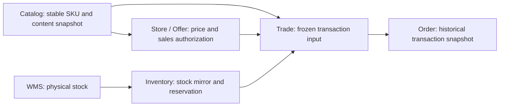

# Goods Catalog Module

## Catalog Ownership

Catalog owns product information, not selling permission, transaction prices or inventory. Its domain includes SPU, stable SKU, Product Type, merchant brands, category references, localized attributes, GoodsStyle and published snapshots. The current lifecycle is `DRAFT -> PUBLISHED -> ARCHIVED`; publication does not mean a consumer can buy.

**Sources** · [Catalog boundary:64-86](file:///Users/101bjb0467/Sources/j-store/docs/domain-modeling.md#L64-L86)

## Draft and Snapshot Model

Published content is edited through copy-on-write drafts. A draft SPU records `sourceSpuId`; copied SKUs have independent IDs and `sourceSkuId`. Publishing restores stable IDs for existing source SKUs and preserves new IDs for new SKUs. This prevents draft/published aggregates sharing a persistence key and preserves Offer, Inventory and Order references.

Product Type defines SPU/SKU property structure and validation. Brand is a merchant-level aggregate; saving/publishing validates existence, enabled state and merchant scope. Category currently remains a stable reference entity, not a delivered standalone category-tree aggregate. GoodsStyle writes require a DRAFT SPU and participate in coordinated publication; images, attributes and localized text enter the same snapshot version.

**Sources** · [Product structure and publication:66-84](file:///Users/101bjb0467/Sources/j-store/docs/domain-modeling.md#L66-L84)

## Adjacent Contexts

Store/Offer owns `ACTIVE/SUSPENDED/ENDED` sales status and SaleAuthorization. Inventory owns ATP and StockReservation; WMS owns physical stock. Goods no longer owns an inventory service or `ON_SALE/OFF_SALE` state. Older nested Wiki pages with those names describe historical implementations and must not be used as the current authority.

**Sources** · [Context facts:17-26](file:///Users/101bjb0467/Sources/j-store/docs/domain-modeling.md#L17-L26) · [Offer and ATP:88-131](file:///Users/101bjb0467/Sources/j-store/docs/domain-modeling.md#L88-L131)

## Modules

Catalog has `j-store-goods-domain/application/infrastructure/boot` and `j-store-goods-api`. The published API supplies price-free product snapshots. HTTP/Spring wiring belongs to boot, persistence to infrastructure and product rules to domain.

**Sources** · [Registrations:45-53](file:///Users/101bjb0467/Sources/j-store/backend/settings.gradle.kts#L45-L53) · [Module responsibilities:96-97](file:///Users/101bjb0467/Sources/j-store/docs/project-overview.md#L96-L97)
