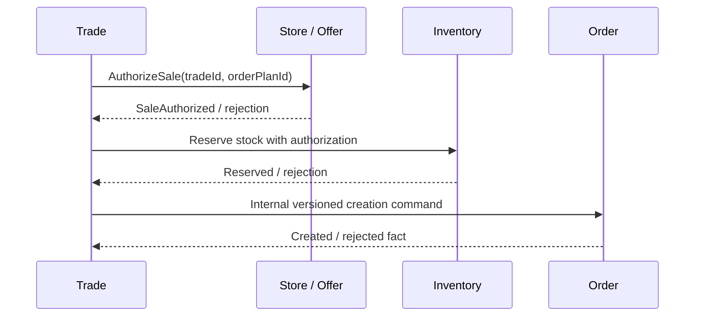

# Stock Integration & Reservation

## Ownership

Trade, not Order, coordinates sales authorization and stock reservation. Store/Offer owns SaleAuthorization, Inventory owns StockReservation/ATP and WMS owns physical stock. Order records the resulting individual transaction and historical snapshots without becoming a resource-commitment coordinator.

**Sources** · [Ownership:19-26](file:///Users/101bjb0467/Sources/j-store/docs/domain-modeling.md#L19-L26) · [Trade relationships:56-62](file:///Users/101bjb0467/Sources/j-store/docs/domain-modeling.md#L56-L62)

## Durable Sequence

Authorization locks stores/offers in stable order and validates merchant/reference/version/price/time/quantity. Reservations use `tradeId + orderPlanId`, not an Order ID invented before Order creation. All plans must reserve before Order creation; all Orders and amount conservation must precede settlement preparation.

**Sources** · [Authorization checks:68-140](file:///Users/101bjb0467/Sources/j-store/backend/j-store-shop-application/src/main/kotlin/com/jstore/shop/service/OfferAuthorizationService.kt#L68-L140) · [Trade barriers:143-162](file:///Users/101bjb0467/Sources/j-store/docs/domain-modeling.md#L143-L162)

## Failure and Return Semantics

Local transactions and Outbox persist commands/facts; duplicate delivery must converge through business idempotency. Uncertain payment/cancellation results do not justify releasing commitments by local timeout. Cancellation during provider preparation records an in-flight cancellation state; matched provider cancellation facts allow Trade compensation.

Refund success alone never increases physical stock. Return receipt/inspection is a WMS responsibility. Old Order stock handlers, Goods Inventory services and JVM InventoryLock descriptions are historical, not the current protocol.

**Sources** · [Physical return boundary:129-131](file:///Users/101bjb0467/Sources/j-store/docs/domain-modeling.md#L129-L131) · [Cancellation and delivery limits:160-164](file:///Users/101bjb0467/Sources/j-store/docs/domain-modeling.md#L160-L164)
