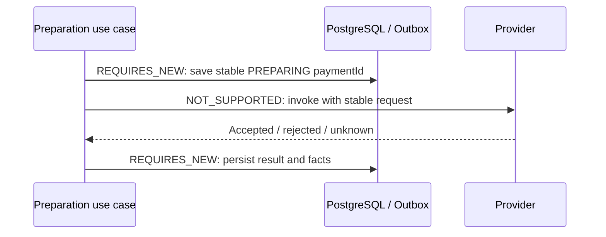

# Payment Processing Module

## Current Checkout Payment Model

Checkout payment preparation uses `TradePayment`, keyed by a unique SettlementPlan installment rather than one public payment creation per Order. The aggregate stores `tradeId`, `settlementPlanId`, `installmentId`, amount/currency and frozen allocations to Order plans/Orders/merchants. Allocation sums must match payable amount.

Status values include PREPARING, READY, REJECTED, UNCERTAIN, PREPARATION_CANCELLING, CANCELLING and CANCELLED, plus CAPTURED/REFUNDED model values. An enum value does not establish a completed provider capture/refund integration.

**Sources** · [Identity, status and invariants:28-136](file:///Users/101bjb0467/Sources/j-store/backend/j-store-payment-domain/src/main/kotlin/com/jstore/payment/domain/payment/TradePayment.kt#L28-L136)

## Durable Provider Interaction

Preparation and cancellation use the same transaction operations: start durably, invoke the provider without a database transaction, complete durably. Retries reuse stable payment/provider business identities rather than creating unrelated payment attempts. READY requires valid provider acceptance and an unexpired controlled action when queried by Checkout.

**Sources** · [Transaction operations and orchestration:35-103](file:///Users/101bjb0467/Sources/j-store/backend/j-store-payment-boot/src/main/kotlin/com/jstore/payment/config/TransactionalTradePaymentPreparationUseCase.kt#L35-L103) · [READY validation:154-188](file:///Users/101bjb0467/Sources/j-store/backend/j-store-payment-domain/src/main/kotlin/com/jstore/payment/domain/payment/TradePayment.kt#L154-L188)

## Cancellation Race

When cancellation arrives during provider preparation, Payment records PREPARATION_CANCELLING and waits for that invocation's result. Late acceptance is recorded with the provider reference and transitions to CANCELLING. Unknown provider results remain unresolved; only matching cancellation facts can drive Trade resource compensation. A local deadline is not proof that funds cannot arrive.

**Sources** · [Late acceptance behavior:191-238](file:///Users/101bjb0467/Sources/j-store/backend/j-store-payment-domain/src/main/kotlin/com/jstore/payment/domain/payment/TradePayment.kt#L191-L238) · [Cross-context cancellation:160-162](file:///Users/101bjb0467/Sources/j-store/docs/domain-modeling.md#L160-L162)

## Query and Delivery Boundaries

Trade stores installment Payment references and queries `payment-api` for a READY action. Payment-action expiry hides the nullable Checkout payment without making Trade status unreadable. Production provider preparation/cancellation adapters are not delivered; nonproduction adapters support internal development and missing real production adapters fail startup. Scheduled provider query, capture, late-payment refunds and policy-driven fulfillment release remain follow-up slices.

Other PaymentOrder/refund code and controllers coexist in the context; they must not be mistaken for a second Checkout orchestration path or proof that all Trade funds lifecycle slices are complete.

**Sources** · [Current payment scope:107](file:///Users/101bjb0467/Sources/j-store/docs/project-overview.md#L107-L107) · [Delivery limits:129](file:///Users/101bjb0467/Sources/j-store/docs/project-overview.md#L129-L129)
