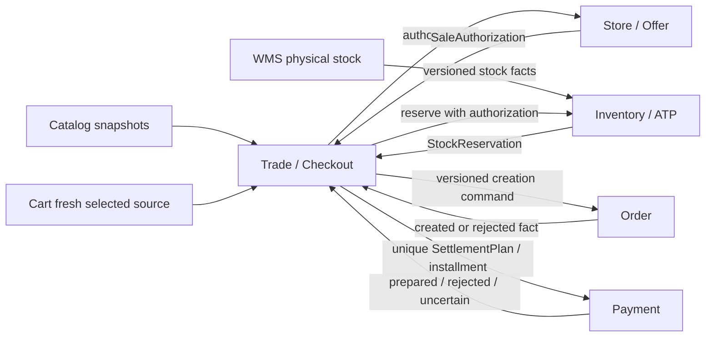

# Project Overview

## Introduction

j-store is an internally developed Kotlin/Spring Boot commerce platform. The backend runs as a modular monolith; Gradle modules are bounded-context and layering boundaries, not independently deployed services. The repository also contains an independent blank administration frontend.

The current catalog declares Kotlin 2.4.10 and Spring Boot 3.5.16. The backend Java toolchain is 25. PostgreSQL, Redis, JPA, Flyway, versioned integration messages and transactional Outbox support the runtime.

**Sources** · [Versions:1-28](file:///Users/101bjb0467/Sources/j-store/backend/gradle/libs.versions.toml#L1-L28) · [Java toolchain:20-23](file:///Users/101bjb0467/Sources/j-store/backend/build.gradle.kts#L20-L23)

## Repository Structure

```text
backend/                 Independent Gradle build; 64 registered modules
  gradle/                Wrapper and version catalog
  j-store-*/             Context layers and shared runtime capabilities
  docker/                Local container resources
frontend/                Independent pnpm workspace
  apps/admin-web/        React/TypeScript/Vite/Ant Design blank application
docs/                    Domain model, specifications, steering and operations
scripts/                 Build entry points, checks and delivery tools
tests/                   Repository governance and tooling tests
deploy/                  Host and Kubernetes delivery resources
observability/           Metrics, tracing and logging configuration
config/                  Shared formatting, licensing and CI configuration
```

The root directory is neither the Gradle build root nor the pnpm workspace. JVM tests live with their backend modules. Frontend browser tests live under the administration application.

**Sources** · [Module registration:5-133](file:///Users/101bjb0467/Sources/j-store/backend/settings.gradle.kts#L5-L133) · [Repository layout:9-39](file:///Users/101bjb0467/Sources/j-store/docs/project-overview.md#L9-L39)

## Bounded Contexts

| Context | Current responsibility |
| --- | --- |
| Catalog (`goods`) | SPU, stable SKU, Product Type, merchant brands, localized content, copy-on-write drafts and published snapshots; lifecycle `DRAFT/PUBLISHED/ARCHIVED` |
| Store / Offer (`shop`) | Merchant membership, stores, offer price and eligibility, persistent `SaleAuthorization` |
| Inventory / ATP | Stock mirror, safety stock, isolated quantity and persistent `StockReservation` |
| WMS (`warehouse`) | Physical stock and monotonic source versions |
| Cart | Mutable buyer intent, absolute item quantities, selection and derived assessments; no price lock or stock reservation |
| Trade / Checkout | Buyer-scoped request idempotency, frozen source, merchant/fulfillment plans, authorization/reservation Saga, internal Order creation and unique SettlementPlan |
| Order | Frozen transaction and buyer snapshots, individual-order lifecycle, buyer queries/cancellation and after-sale rules |
| Payment | Installment payment preparation/cancellation and refund-related models; provider interaction remains inside Payment |
| Fulfillment | Fulfillment order lifecycle and persistence |
| Accounting | Accounts, periods, journals and settlement facts |
| User / Authentication | Local accounts, WeChat identity binding, OAuth 2.0/OIDC, authorization persistence and Redis-backed sessions |

**Sources** · [Context ownership:15-62](file:///Users/101bjb0467/Sources/j-store/docs/domain-modeling.md#L15-L62)

## Commerce Flow



Checkout owns an independent `tradeId`; resource commitments use `tradeId + orderPlanId`. Orders are created only after commitments, and one SettlementPlan is prepared after all plans have orders and their amounts balance. Payment first commits a stable PREPARING identity, invokes the provider outside a database transaction, then commits the result separately.

**Sources** · [Checkout planning:142-197](file:///Users/101bjb0467/Sources/j-store/backend/j-store-trade-application/src/main/kotlin/com/jstore/trade/service/CheckoutApplicationService.kt#L142-L197) · [Payment transaction phases:35-103](file:///Users/101bjb0467/Sources/j-store/backend/j-store-payment-boot/src/main/kotlin/com/jstore/payment/config/TransactionalTradePaymentPreparationUseCase.kt#L35-L103)

## Current HTTP Surface

- `POST /api/checkouts`: authenticated direct purchase or Cart source; returns HTTP 202 with `tradeId`, `statusUrl` and current `orderIds`.
- `GET /api/checkouts/{tradeId}`: buyer-scoped status and optional READY, unexpired payment action.
- Cart: `GET /api/carts/current`, `PUT /api/carts/current/items`, `PUT /api/carts/current/selection`, `POST /api/carts/current/refresh`.
- Order: authenticated list/detail and `POST /api/orders/{orderId}/cancel`. Public Order creation has been removed.
- User: phone verification, verified registration, own profile/nickname/password and session logout; token acquisition uses the OIDC protocol rather than custom login/refresh endpoints.

The current Checkout controller and `CheckoutUseCase` do **not** expose a Checkout cancellation operation. Internal payment cancellation/Saga behavior must not be described as a public `POST /api/checkouts/{tradeId}/cancel` implementation.

**Sources** · [Checkout controller:29-158](file:///Users/101bjb0467/Sources/j-store/backend/j-store-trade-boot/src/main/kotlin/com/jstore/trade/controller/CheckoutController.kt#L29-L158) · [Checkout use-case contract:122-130](file:///Users/101bjb0467/Sources/j-store/backend/j-store-trade-application/src/main/kotlin/com/jstore/trade/service/CheckoutApplicationService.kt#L122-L130) · [Cart controller:32-114](file:///Users/101bjb0467/Sources/j-store/backend/j-store-cart-boot/src/main/kotlin/com/jstore/cart/controller/CartController.kt#L32-L114) · [Order endpoints:98-150](file:///Users/101bjb0467/Sources/j-store/backend/j-store-order-boot/src/main/kotlin/com/jstore/order/controller/OrderController.kt#L98-L150) · [User endpoints:79-154](file:///Users/101bjb0467/Sources/j-store/backend/j-store-user-boot/src/main/kotlin/com/jstore/user/controller/UserAccountController.kt#L79-L154)

## Shared Infrastructure

`common-core` contains framework-independent primitives. `common-spring` is limited to shared geographic-address integration. Messaging contracts/buses, Outbox contracts/runtime and observability have dedicated modules. `outbox-core` contains immutable publication and backend contracts; polling state and repositories belong to `outbox-spring`. Stable transport IDs describe routing targets, not proof that a production broker adapter is deployed.

**Sources** · [Shared modules:82-90](file:///Users/101bjb0467/Sources/j-store/docs/project-overview.md#L82-L90) · [Outbox backend selection:33-48](file:///Users/101bjb0467/Sources/j-store/backend/j-store-outbox-spring/src/main/kotlin/com/jstore/outbox/spring/OutboxAutoConfiguration.kt#L33-L48)

## Development and Verification

```bash
./scripts/backend-gradle.sh projects
./scripts/backend-gradle.sh test
./scripts/backend-gradle.sh :j-store-boot:bootJar
pnpm --dir frontend install --frozen-lockfile
pnpm --dir frontend dev
pnpm --dir frontend check
./scripts/quality-gate.sh
```

External JVM coordinates come from the version catalog; version alignment belongs to `j-store-dependencies-platform`. Internal interfaces and disposable development data evolve directly unless approved requirements explicitly mandate compatibility.

**Sources** · [Backend entry points:3-19](file:///Users/101bjb0467/Sources/j-store/backend/README.md#L3-L19) · [Frontend status:59-64](file:///Users/101bjb0467/Sources/j-store/docs/project-overview.md#L59-L64) · [Dependency ownership:10-32](file:///Users/101bjb0467/Sources/j-store/docs/steering/dependency-management-guidelines.md#L10-L32)

## Delivery Boundaries and Wiki Coverage

The administration frontend has only a minimal entry and 404 fallback; business pages, authentication and BFF integration are not delivered. Production payment adapters, active provider queries, capture, late-payment refunds and explicit fulfillment release remain follow-up slices. Real WeChat/SMS integration and independent authentication review remain incomplete.

This local export is not a Knowledge Center publication. The refreshed overview, architecture, build, API and selected context pages describe current verified boundaries; untouched detailed pages can still contain historical paths and behavior. Consult current source and authoritative domain/specification documents before treating those pages as implementation evidence. No build, runtime or production-readiness claim follows from a documentation refresh.

**Sources** · [Current delivery limits:126-129](file:///Users/101bjb0467/Sources/j-store/docs/project-overview.md#L126-L129) · [Trade follow-up boundaries:159-162](file:///Users/101bjb0467/Sources/j-store/docs/domain-modeling.md#L159-L162)
