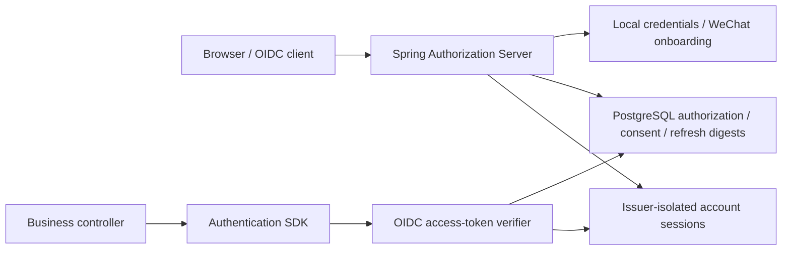

# User Authentication Module

## Architecture

User owns local account credentials/status, external identity bindings and authentication facts. Spring Authorization Server implements OAuth 2.0/OIDC. The authentication SDK provides MVC login annotations, principal argument resolution and an `AccessTokenVerifier` port; it does not own User domain or merchant membership policies.

**Sources** · [OIDC configuration:59-66](file:///Users/101bjb0467/Sources/j-store/backend/j-store-user-boot/src/main/kotlin/com/jstore/user/oidc/OidcConfiguration.kt#L59-L66) · [Authorization and verifier wiring:170-201](file:///Users/101bjb0467/Sources/j-store/backend/j-store-user-boot/src/main/kotlin/com/jstore/user/oidc/OidcConfiguration.kt#L170-L201)

## OIDC and Sessions

Token acquisition uses Authorization Code + PKCE S256. Clients require proof keys/consent; configured token lifetimes are authorization code 60 seconds, access token 15 minutes and refresh token 7 days. Refresh grants require a confidential client with `offline_access`. RSA keys must carry unique key IDs and be at least 2048 bits; JWT decoding selects RS256 and validates timestamp/issuer.

PostgreSQL stores protocol authorization, clients, consent and token digests. Refresh-family replay handling revokes the family; refreshing replaces the family's active access token. Redis stores browser/account session state and an issuer-isolated epoch barrier. Dependency failures must not degrade authentication to signature-only acceptance.

**Sources** · [Signing/client settings:69-153](file:///Users/101bjb0467/Sources/j-store/backend/j-store-user-boot/src/main/kotlin/com/jstore/user/oidc/OidcConfiguration.kt#L69-L153) · [Session semantics:197-200](file:///Users/101bjb0467/Sources/j-store/docs/domain-modeling.md#L197-L200)

## WeChat and Accounts

WeChat identity does not replace local account identity. An unbound identity produces short-lived onboarding intent; verified phone and explicit confirmation are required before binding to an ACTIVE account or registering one. Binding uniqueness is scoped by provider/application/subject and provider/application/user. Union ID does not trigger automatic cross-application account merging.

User HTTP routes cover phone verification, registration, own profile, nickname/password changes and session logout. Old custom login/refresh token APIs are removed. Profile query consumers use `user-api`, with optional remote `user-client-spring` adapters.

**Sources** · [External identity:189-201](file:///Users/101bjb0467/Sources/j-store/docs/domain-modeling.md#L189-L201) · [User HTTP routes:79-154](file:///Users/101bjb0467/Sources/j-store/backend/j-store-user-boot/src/main/kotlin/com/jstore/user/controller/UserAccountController.kt#L79-L154) · [Profile query modules:109-112](file:///Users/101bjb0467/Sources/j-store/docs/project-overview.md#L109-L112)

## Delivery Status

Real WeChat/SMS integration, independent review and dependency-scan findings are not fully closed. Local or simulated tests are not production-readiness evidence.

**Sources** · [Delivery status:126](file:///Users/101bjb0467/Sources/j-store/docs/project-overview.md#L126-L126)
